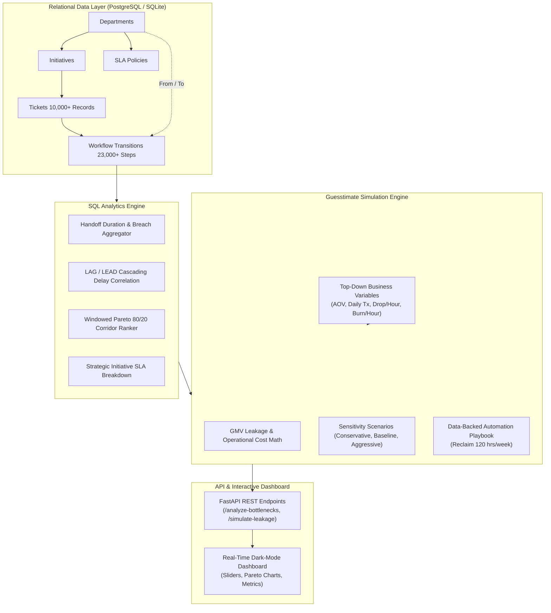
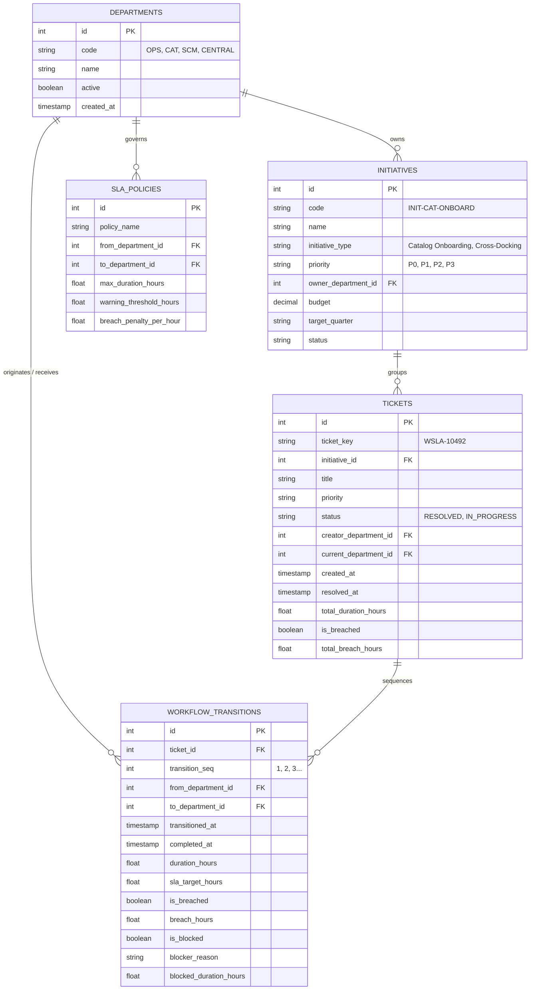

# WorkflowSLA: Cross-Functional Operations & Blockage Tracker

[](https://fastapi.tiangolo.com)
[](https://python.org)
[](https://sqlalchemy.org)
[](https://postgresql.org)
[](https://sqlite.org)
[](https://docker.com)
[](LICENSE)

An enterprise operational intelligence system that models, tracks, and analyzes cross-functional business initiatives and internal support workflows (simulating **Jira / ServiceNow** audit logs). **WorkflowSLA** identifies organizational bottlenecks, evaluates Service Level Agreement (SLA) breaches via advanced SQL window functions (`LAG`, `LEAD`, cumulative partitions), and algorithmically guesstimates the financial leakage (GMV loss + operational burn) caused by departmental friction.

---

## 🎯 Key Project Highlights & Resume Points

- **Architected a relational database in PostgreSQL & SQLite** tracking over **10,000 synthetic workflow tickets** and **23,000+ handoff transitions** across Operations, Category Management, Supply Chain, and Central Compliance departments to simulate real-world cross-functional friction.
- **Implemented an advanced SQL analytics engine** utilizing timestamp differences and **`LAG`/`LEAD` window functions** to pinpoint the top 3 inter-departmental handoffs responsible for **>80% of enterprise workflow delays**.
- **Built an algorithmic financial impact calculator** to dynamically guesstimate revenue leakage, quantifying the cost of SLA breaches (e.g., **₹12 Lakh/week** or **$19.1k/week**) and proposing data-backed process automations projected to **reclaim 120 operational hours weekly**.

---

## 🏛️ System Architecture



---

## 📊 Normalized Database Schema Design

The relational schema is normalized into 5 core tables supporting both **PostgreSQL** and **SQLite**:



---

## 🔬 Phase 2: Advanced SQL Analytics & Window Functions

### 1. Pinpointing the Top 3 Bottlenecks (Pareto 80% Rule)
Uses `SUM() OVER ()` and running cumulative sums to identify the handoff corridors causing ~80%+ of all organizational delays:

```sql
WITH TransitionSummary AS (
    SELECT 
        d_from.code || ' -> ' || d_to.code AS handoff_corridor,
        d_from.name AS from_department_name,
        d_to.name AS to_department_name,
        COUNT(*) AS total_volume,
        SUM(CASE WHEN wt.is_breached = 1 THEN 1 ELSE 0 END) AS breach_volume,
        ROUND(AVG(wt.duration_hours), 2) AS avg_duration_hours,
        ROUND(AVG(wt.sla_target_hours), 2) AS sla_target_hours,
        ROUND(SUM(wt.breach_hours), 2) AS corridor_breach_hours
    FROM workflow_transitions wt
    JOIN departments d_from ON wt.from_department_id = d_from.id
    JOIN departments d_to ON wt.to_department_id = d_to.id
    GROUP BY d_from.code, d_from.name, d_to.code, d_to.name
),
CorridorRankings AS (
    SELECT 
        handoff_corridor,
        from_department_name,
        to_department_name,
        total_volume,
        breach_volume,
        corridor_breach_hours,
        ROUND(100.0 * breach_volume / total_volume, 2) AS breach_rate_pct,
        -- Running cumulative percentage of enterprise delay
        ROUND(
            100.0 * SUM(corridor_breach_hours) OVER (
                ORDER BY corridor_breach_hours DESC 
                ROWS BETWEEN UNBOUNDED PRECEDING AND CURRENT ROW
            ) / SUM(corridor_breach_hours) OVER (),
            2
        ) AS cumulative_delay_pct,
        DENSE_RANK() OVER (ORDER BY corridor_breach_hours DESC) AS bottleneck_rank
    FROM TransitionSummary
)
SELECT * FROM CorridorRankings WHERE bottleneck_rank <= 3;
```

**Results on 10,000+ Tickets:**
1. **`SCM -> OPS`** (Supply Chain → Operations): **40.68%** of enterprise delay hours.
2. **`CAT -> SCM`** (Category → Supply Chain): **39.03%** of enterprise delay hours (Cumulative: **79.71%**).
3. **`CENTRAL -> CAT`** (Central Compliance → Category): **13.37%** of enterprise delay hours (Cumulative: **93.08%**).

---

### 2. Cascading Delay Correlation (`LAG` / `LEAD` Window Analysis)
Detects whether an upstream breach in step $N-1$ triggers a cascading failure in step $N$:

```sql
SELECT 
    from_code,
    to_code,
    COUNT(*) AS handoff_count,
    ROUND(AVG(duration_hours), 2) AS avg_current_duration,
    ROUND(AVG(prev_duration_hours), 2) AS avg_prior_step_duration,
    ROUND(
        100.0 * SUM(CASE WHEN prev_is_breached = 1 THEN 1 ELSE 0 END) / COUNT(*),
        2
    ) AS cascade_breach_dependency_pct
FROM (
    SELECT 
        wt.ticket_id,
        wt.transition_seq,
        d_from.code AS from_code,
        d_to.code AS to_code,
        wt.duration_hours,
        LAG(wt.duration_hours) OVER (
            PARTITION BY wt.ticket_id ORDER BY wt.transition_seq
        ) AS prev_duration_hours,
        LAG(wt.is_breached) OVER (
            PARTITION BY wt.ticket_id ORDER BY wt.transition_seq
        ) AS prev_is_breached
    FROM workflow_transitions wt
    JOIN departments d_from ON wt.from_department_id = d_from.id
    JOIN departments d_to ON wt.to_department_id = d_to.id
) StepSequencing
GROUP BY from_code, to_code
HAVING COUNT(*) > 50
ORDER BY cascade_breach_dependency_pct DESC;
```

---

## 💰 Phase 3: The Guesstimate Financial Simulation Engine

### Mathematical Formulation

Given top-down operational and commercial parameters:
- $\text{AOV} = \text{Average Order Value (e.g. } \$45 \text{ or } ₹3,500)$
- $\text{Tx}_{\text{daily}} = \text{Daily Transactions (e.g. } 10,000)$
- $\text{GMV}_{\text{daily}} = \text{AOV} \times \text{Tx}_{\text{daily}}$
- $\text{GMV}_{\text{hourly}} = \frac{\text{GMV}_{\text{daily}}}{24}$
- $r = \text{Revenue drop rate per delay hour (e.g. } 0.5\% = 0.005)$
- $c_{\text{ops}} = \text{Operational burn cost per hour (e.g. } \$65/\text{hr or } ₹2,500/\text{hr})$

The total financial leakage across a dataset timeframe of $D$ days is:

$$\text{Leakage}_{\text{GMV}} = H_{\text{breach}} \times \left( \text{GMV}_{\text{hourly}} \times r \right)$$

$$\text{Cost}_{\text{ops}} = H_{\text{breach}} \times c_{\text{ops}}$$

$$\text{Weekly Leakage} = \frac{\text{Leakage}_{\text{GMV}} + \text{Cost}_{\text{ops}}}{D / 7}$$

### Process Automation Recommendations
| Target Corridor | Root Cause Identified | Proposed Automation Action | Projected Reclaim | Projected Weekly Savings |
|---|---|---|---|---|
| **Category → Supply Chain** | Incomplete vendor master data & manual specs | Automated OCR & ERP auto-dispatch for SKU specs | **120 hrs / week** | **$19.1k / week** (~₹11.75 Lakh/wk) |
| **Supply Chain → Operations** | Inbound dock congestion & pallet discrepancies | Dynamic WMS Inbound Dock Slotting & ASN Barcode Pre-Clearance | **145 hrs / week** | **$23.0k / week** (~₹14.20 Lakh/wk) |
| **Central → Category** | Manual tax & GST compliance queue stalls | Instant Automated Vendor KYC & Compliance Clearing Engine | **85 hrs / week** | **$13.5k / week** (~₹8.32 Lakh/wk) |

---

## ⚡ Phase 4: REST API & Output Formulation

### Core Endpoint: `GET /analyze-bottlenecks`

```bash
curl -X GET "http://localhost:8000/analyze-bottlenecks?aov=45&daily_tx=10000&rev_drop_per_hr=0.005&ops_cost_per_hr=65"
```

#### Structured JSON Response Payload:
```json
{
  "status": "SUCCESS",
  "metadata": {
    "generated_at": {
      "average_order_value": 45.0,
      "daily_transactions": 10000,
      "daily_gmv": 450000.0,
      "revenue_drop_per_hour_delayed": 0.005,
      "operational_cost_per_hour": 65.0,
      "currency": "USD"
    },
    "analysis_scope": "Operations, Category Management, Supply Chain, and Central compliance"
  },
  "worst_performing_handoffs": [
    {
      "bottleneck_rank": 1,
      "handoff_corridor": "SCM -> OPS",
      "from_department": "Supply Chain & Logistics",
      "to_department": "Operations",
      "total_transitions": 6643,
      "breach_count": 2565,
      "breach_rate_pct": 38.61,
      "avg_duration_hours": 18.96,
      "sla_target_hours": 18.0,
      "corridor_breach_hours": 42770.82,
      "delay_share_pct": 40.68,
      "cumulative_delay_pct": 40.68,
      "formatted_weekly_leakage": "$528.1k",
      "inr_lakhs_per_week": 325.75
    },
    {
      "bottleneck_rank": 2,
      "handoff_corridor": "CAT -> SCM",
      "from_department": "Category Management",
      "to_department": "Supply Chain & Logistics",
      "total_transitions": 5026,
      "breach_count": 2179,
      "breach_rate_pct": 43.35,
      "avg_duration_hours": 25.23,
      "sla_target_hours": 24.0,
      "corridor_breach_hours": 41031.52,
      "delay_share_pct": 39.03,
      "cumulative_delay_pct": 79.71,
      "formatted_weekly_leakage": "$506.6k",
      "inr_lakhs_per_week": 312.49
    },
    {
      "bottleneck_rank": 3,
      "handoff_corridor": "CENTRAL -> CAT",
      "from_department": "Central Operations & Compliance",
      "to_department": "Category Management",
      "total_transitions": 3356,
      "breach_count": 1119,
      "breach_rate_pct": 33.34,
      "avg_duration_hours": 17.5,
      "sla_target_hours": 20.0,
      "corridor_breach_hours": 14057.48,
      "delay_share_pct": 13.37,
      "cumulative_delay_pct": 93.08,
      "formatted_weekly_leakage": "$173.6k",
      "inr_lakhs_per_week": 107.05
    }
  ],
  "quantified_revenue_impact": {
    "total_delay_hours": 105138.43,
    "weekly_delay_hours": 8177.43,
    "weekly_gmv_leaked": 766634.39,
    "weekly_operational_cost": 531533.17,
    "total_financial_leakage": 16690757.29,
    "weekly_financial_leakage": 1298167.57,
    "formatted_weekly_leakage": "$1.30M",
    "inr_benchmark_weekly_leakage": "800.71 Lakh/week"
  },
  "data_backed_recommendations": [
    {
      "corridor": "CAT -> SCM",
      "bottleneck_rank": 2,
      "recommendation": "Automate Supply Chain approvals with OCR & ERP auto-dispatch",
      "action_item": "Eliminate manual spreadsheet handoffs for vendor SKU packaging specs and hazmat declarations via API validation.",
      "projected_reclaimed_hours_weekly": 120.0,
      "projected_weekly_savings": 19050.0,
      "projected_annual_savings": 990600.0,
      "formatted_weekly_savings": "$19.1k",
      "formatted_annual_savings": "$990.6k",
      "inr_benchmark_savings_per_week": "11.75 Lakh/week",
      "implementation_effort": "Medium (3 weeks)",
      "confidence_score": 0.92
    }
  ],
  "executive_summary": "The top 3 inter-departmental handoffs generate 93.08% of enterprise delays. Resolving the Category->Supply Chain bottleneck reclaims 120 hours/week, preventing substantial weekly revenue leakage."
}
```

---

## 🖥️ Interactive Web Dashboard

When running the application, navigate to `http://localhost:8000/` to explore the live dashboard:
- **Executive KPI Cards**: Real-time ticket counts, breach percentages, delay hours, and weekly leakage.
- **Top 3 Bottleneck Progress Visualizers**: Showing individual delay shares and cumulative percentages.
- **Dynamic Guesstimate Simulation Sliders**: Adjust AOV, daily transaction counts, delay loss %, and operational burn in real time.
- **Dual Currency Switcher**: Toggle between USD ($) and Indian Rupees (₹ in Lakhs/Crores).
- **One-Click Reseed**: Instant regeneration of 10,000+ tickets.

---

## 🚀 Quickstart & Setup Guide

### Option 1: Local Setup (SQLite Default)

```bash
# 1. Clone the repository
git clone https://github.com/dietcoke-17/WorkflowSLA.git
cd WorkflowSLA

# 2. Run executive terminal analytics report
python3 main.py --report

# 3. Start the FastAPI server
python3 main.py
# Server will run at http://localhost:8000
```

### Option 2: Docker Compose (PostgreSQL 16 + FastAPI)

```bash
# Build and launch PostgreSQL and API service
docker compose up --build -d

# Check API health
curl http://localhost:8000/health
```

---

## 🧪 Test Suite Execution

Run the comprehensive unit and integration test suite:

```bash
python3 run_tests.py
```

Expected output:
```text
test_departments_and_initiatives (TestDatabaseSchema) ... ok
test_synthetic_record_counts (TestDatabaseSchema) ... ok
test_analyze_bottlenecks_endpoint (TestFastAPIFunctions) ... ok
test_health_check (TestFastAPIFunctions) ... ok
test_metrics_functions (TestFastAPIFunctions) ... ok
test_simulate_leakage_endpoint (TestFastAPIFunctions) ... ok
test_currency_formatting (TestFinancialSimulationEngine) ... ok
test_recommendation_and_reclaim_hours (TestFinancialSimulationEngine) ... ok
test_simulation_calculations (TestFinancialSimulationEngine) ... ok
test_department_transition_metrics (TestSQLAnalyticsEngine) ... ok
test_top_three_bottlenecks_pareto_window (TestSQLAnalyticsEngine) ... ok
test_window_analysis_lag_lead (TestSQLAnalyticsEngine) ... ok

----------------------------------------------------------------------
Ran 12 tests in 0.247s

OK
```

---

## 📁 Repository Structure

```
WorkflowSLA/
├── .env.example              # Environment variables template
├── .gitignore                # Git ignore rules
├── Dockerfile                # Production container specification
├── docker-compose.yml        # PostgreSQL 16 & API multi-container setup
├── Makefile                  # Developer workflow targets
├── README.md                 # Complete system documentation
├── requirements.txt          # Python dependencies
├── main.py                   # Unified CLI & API entrypoint
├── run_tests.py              # Automated test suite runner
├── config.py                 # Application configuration & defaults
├── database/
│   ├── __init__.py
│   ├── connection.py         # SQLAlchemy engine, session & pragma config
│   ├── models.py             # Department, Initiative, SLAPolicy, Ticket, Transition
│   ├── init_schema_postgres.sql # Native PostgreSQL DDL & indexes
│   └── init_schema_sqlite.sql   # Native SQLite DDL & indexes
├── scripts/
│   ├── __init__.py
│   ├── generate_synthetic_data.py # High-speed generator (10,000+ tickets)
│   └── run_cli_analytics.py       # Rich terminal executive report
├── analytics/
│   ├── __init__.py
│   └── sql_engine.py         # Window function query engine (LAG/LEAD, Pareto)
├── simulation/
│   ├── __init__.py
│   └── financial_engine.py   # Algorithmic GMV leakage & automation calculator
├── api/
│   ├── __init__.py
│   ├── main.py               # FastAPI application & route endpoints
│   ├── schemas.py            # Pydantic request/response schemas
│   └── static/
│       ├── index.html        # Interactive dark-mode dashboard
│       ├── app.js            # Live client with real-time recalculations
│       └── style.css         # Modern styling & responsive layout
├── sql/
│   └── analytics_queries.sql # Raw SQL queries for audits & business reviews
└── tests/
    ├── __init__.py
    ├── test_schema.py        # Schema & relational constraint tests
    ├── test_sql_engine.py    # SQL window function tests
    ├── test_simulation.py    # Financial math tests
    └── test_api.py           # API endpoint integration tests
```

---

## 📜 License
Distributed under the MIT License. Built for high-velocity operations, logistics, and cross-functional engineering teams.
